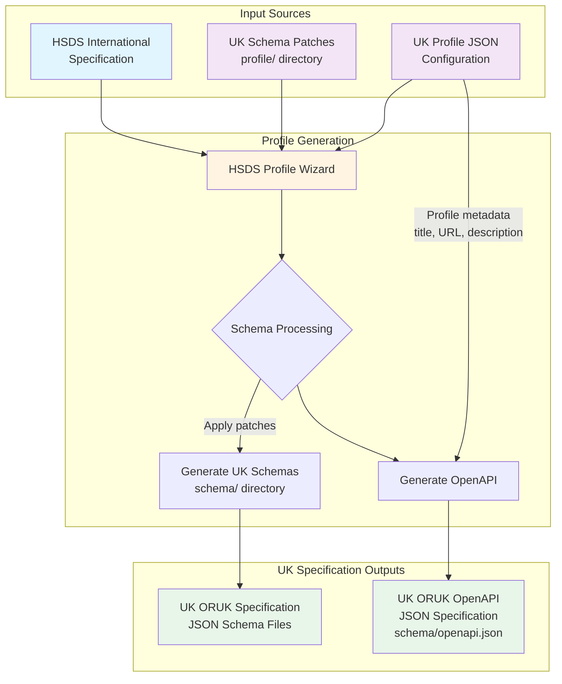

# ORUK-specification

## UK Profile Generation Process

The following diagram illustrates how the Open Referral UK (ORUK) specification is generated from the international HSDS (Human Services Data Specification) using the HSDS Profile Wizard:

### Process Steps

1. **Input Sources**:
   - **HSDS International Specification**: Base schemas from the international Human Services Data Specification
   - **[Profile Configuration](./UK/profile.json)**: Metadata including title, base URL, version, and description for the UK profile
   - **[Schema Patches](./UK/profile/)** (`profile/` directory): UK-specific modifications to extend or restrict HSDS schemas

2. **Profile Wizard Processing**:
   - Fetches HSDS schemas from branch `3.0`
   - Applies UK schema patches to customize fields, add UK-specific attributes, or remove unnecessary elements
   - Updates `$id` values based on the UK profile's base URL
   - Generates the patched schemas, including the explicitly defined list-response schemas

3. **Generated Outputs**:
   - **[UK JSON Schemas](./UK/schema/)**: Localized schema files in the `UK/schema/` directory
   - **[OpenAPI JSON](./UK/schema/openapi.json)**: API specification document describing the UK ORUK REST API endpoints

### Regenerating the UK profile

#### GitHub Action

Run [Generate profile schemas (HSDS Profile Wizard)](./.github/workflows/hsds-profile-wizard.yml)
manually from the repository's **Actions** tab. The workflow checks out `main`,
generates schemas using [UK/profile.json](./UK/profile.json) and
[UK/profile](./UK/profile/), and commits changes under [UK/schema](./UK/schema/)
to a new `feature/hsds-profile-wizard-<run id>-<attempt>` branch. It provides a
comparison link for opening a pull request; it does not update `main` directly
or create a branch when generation produces no changes.

Inputs match the source action:

- `hsds_branch`: HSDS specification branch (default `3.0`).
- `wizard_ref`: wizard branch or tag (default `main`).

The run summary records the wizard commit, changed files, and generation output.
If a `UK/schema/compiled` directory is added by separate tooling in future,
the action preserves it, matching the source workflow.