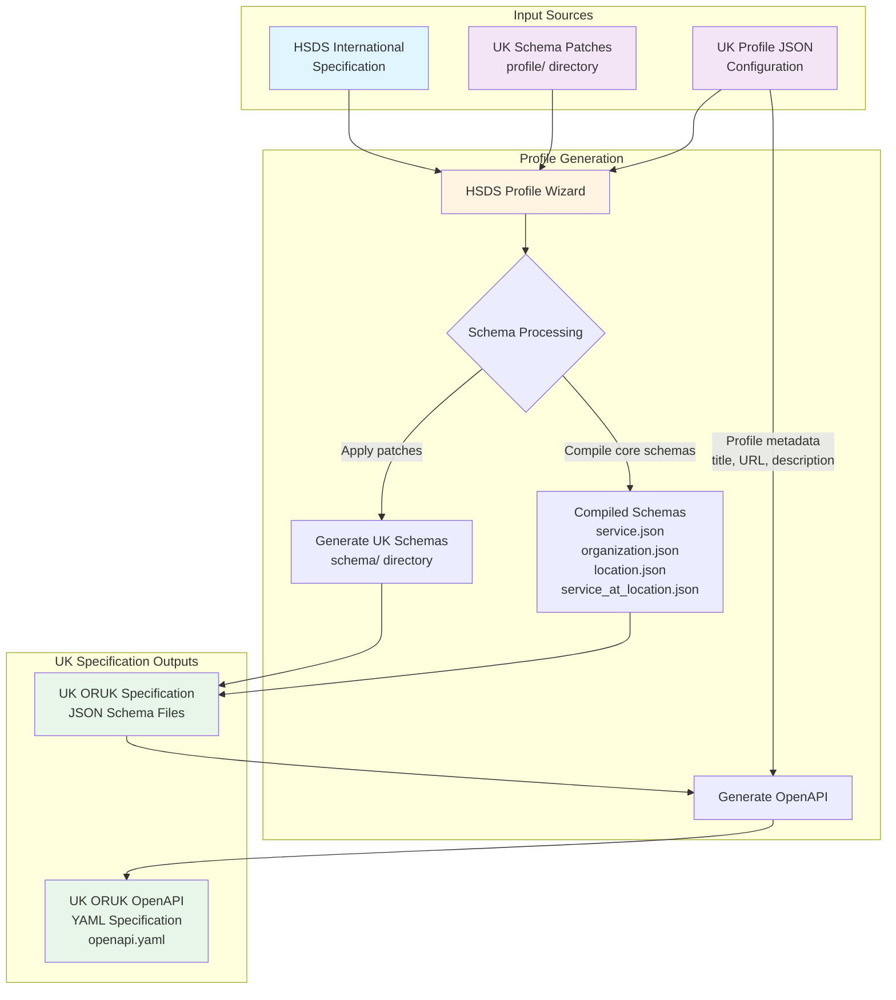

# ORUK-specification

## UK Profile Generation Process

The following diagram illustrates how the Open Referral UK (ORUK) specification is generated from the international HSDS (Human Services Data Specification) using the HSDS Profile Wizard:

### Process Steps

1. **Input Sources**:
   - **HSDS International Specification**: Base schemas from the international Human Services Data Specification
   - **Profile Configuration** (`profile.json`): Metadata including title, base URL, version, and description for the UK profile
   - **[Schema Patches](./UK/profile/)** (`profile/` directory): UK-specific modifications to extend or restrict HSDS schemas

2. **Profile Wizard Processing**:
   - Fetches HSDS schemas from specified branch (default or version-specific)
   - Applies UK schema patches to customize fields, add UK-specific attributes, or remove unnecessary elements
   - Updates `$id` values based on the UK profile's base URL
   - Compiles core schemas (service, organization, location, service_at_location)

3. **Generated Outputs**:
   - **[UK JSON Schemas](./UK/schema/)**: Localized schema files in the `UK/schema/` directory
   - **OpenAPI YAML**: API specification document describing the UK ORUK REST API endpoints

